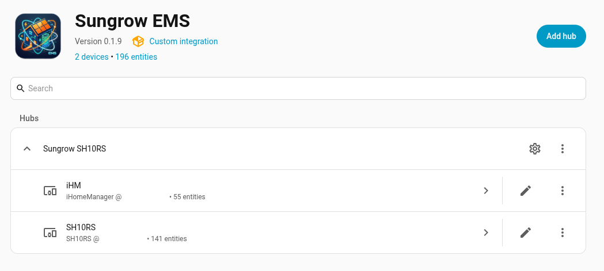

# Sungrow EMS for Home Assistant

<p align="center">
  
</p>

[](https://github.com/Maximo101/sungrow_ems/releases)
[](https://hacs.xyz/docs/faq/custom_repositories)


A **100 % local** Home Assistant integration for Sungrow hybrid inverters and the Sungrow **iHomeManager** (iHM), over Modbus TCP. No iSolarCloud account, no cloud polling and no YAML: everything is configured from the UI and talks directly to the hardware on your LAN.

It replaces a stack of template sensors, utility meters and Riemann integrals with native Python entities, so the energy figures you used to build by hand in `configuration.yaml` come straight from the integration.

> [!WARNING]
> **Beta / pre-release.** It has been tested on one system so far (see [Tested hardware](#tested-hardware)). Please report what works and what doesn't on yours.

## Scope of this release

| | v0.1.4 (this release) | |
|---|---|---|
| **Phase** | 1: Read-only telemetry |
| **Platforms** | `sensor`, `binary_sensor` | adds `select`, `number`, `switch`, services |
| **Writes to hardware** | **None.** Polls only. | Via the iHomeManager, read-back verified |
| **Control** | — | EMS mode, forced charge/discharge + power setpoint, export / active-power limits, AC22 EV charger mode, VPP heartbeat keep-alive |

v0.1.4 never sends a write command (FC06/FC16) to either device. Holding registers such as EMS mode, SOC limits, export limit and EV charger mode are shown as **read-only sensors** only.

---

## Features

- **Fully local Modbus TCP.** Reads the inverter (via WiNet-S / LAN) and the iHomeManager directly. Nothing leaves your network.
- **Two independent coordinators**, one per device, so a slow or offline iHM never stalls inverter data (and vice versa).
- **Fast polling.** 10 s default for both devices (5 s minimum on the inverter). The iHM's mandatory 1 s gap between requests is respected automatically.
- **Efficient block reads.** 161 registers are fetched in 17 batched blocks. If a device rejects part of a block, the hub splits it, remembers the working split, and retries the full block later.
- **Resilient by design.** Last-known-good values are kept through short dropouts. Entities only go unavailable after a configurable number of consecutive failed polls (default 6). Reconnects use exponential backoff.
- **Sentinel filtering.** Sungrow's "not available" values (`0xFFFF`, `0x7FFF`, etc.) and out-of-range readings are dropped instead of showing up as spikes in your history.
- **Native replacements for common YAML templates:**
  - Spike-filtered **Grid Import Safe / Grid Export Safe** totals, with automatic re-baselining (fixes the classic "latched forever" template bug)
  - **Daily import, export and battery charge** meters that reset at local midnight and survive restarts
  - **Daily consumption**, **consumption from PV**, **self-sufficiency** (kWh and %) and **purchased %**
  - **PV split**: battery-charged-from-PV %, consumption-from-PV % and export % (always sum to 100)
  - **Battery stored energy** (capacity read from the hardware, or set manually)
  - Split power sensors: **active import / export** and **battery charging / discharging** power
  - **System Status** text sensor with a dynamic icon, decoded from the power-flow bitfield
- **Binary sensors:** off-grid, inverter fault, EV charger fault.
- **Diagnostics:** per-device poll status sensors showing last success, consecutive failures and how long the values have been unchanged.
- **Runs beside other Sungrow integrations.** Unique IDs carry an `_ems` suffix and devices have their own names, so you can compare old and new side by side before switching over.

## Tested hardware

| Component | Model / firmware | Connection |
|---|---|---|
| Hybrid inverter | SH10RS (10 kW single-phase), WiNet-S | Modbus TCP 502, unit ID 1 |
| Battery | Sungrow SBR192 × 2 (38.4 kWh) | via inverter |
| Gateway | iHomeManager, firmware SV930.001.00.P014 | Modbus TCP 503, unit ID 247 |
| EV charger | Sungrow AC22E-01 | via iHomeManager |

Tested on Home Assistant 2026.10.4.

Other SH-series hybrids that implement the *Communication Protocol of Residential Hybrid Inverter* (V1.1.x) should work, since the register map follows the protocol, but they haven't been tested. Three-phase (RT) models will show some phase B/C entities as unavailable for now. **Reports from other models are very welcome.**

The iHomeManager is optional. Without it you still get every inverter sensor, but grid-meter totals, the EV charger and the iHM-based derived sensors won't be available.

## Requirements

| Device | Port | Unit (slave) ID | Notes |
|---|---|---|---|
| SH-RS hybrid inverter (WiNet-S / WiNet-S2 or LAN) | **502** | **1** | Modbus TCP must be enabled on the dongle |
| iHomeManager | **503** (or 504) | **247** | Fixed by the iHM protocol; one TCP connection per port |

- **Inverter:** Modbus TCP must be enabled on the WiNet-S / WiNet-S2 (or LAN) interface.
- **iHomeManager (optional):** Modbus TCP must be enabled on the iHM during local commissioning (by your installer or via local access). The iHM listens on ports **502, 503 and 504** and allows **only one TCP connection per port**. If another tool (SunGather, another integration) already holds 503, use 504.
- A fixed IP (DHCP reservation) for both devices is strongly recommended.
- Home Assistant **2026.9 or newer**.

## Installation

### Marketplace on Home Assistant (formerly HACS - custom repository)

You can add a custom respository.
1. In Settings go to 'Marketplace', open the menu (⋮) → **Custom repositories**.
2. Add from Link `https://github.com/Maximo101/sungrow_ems` with category **Integration**.
3. Find **Sungrow EMS** in HACS and download it. Pre-releases are listed when you enable **Show beta versions** on the integration's page in HACS.
4. Restart Home Assistant.

<p align="center">
  
</p>

### Manual

1. Download the source code from the [latest release](https://github.com/Maximo101/sungrow_ems/releases).
2. Copy the `custom_components/sungrow_ems/` folder into your `config/custom_components/` folder (so `config/custom_components/sungrow_ems/manifest.json` exists).
3. Restart Home Assistant.

## Configuration

**Settings → Devices & services → Add integration → Sungrow EMS**

| Field | Default | Notes |
|---|---|---|
| Inverter host | — | IP of the WiNet-S / LAN interface |
| Inverter port | 502 | |
| Inverter unit ID | 1 | |
| Use iHomeManager | on | Turn off if you don't have one |
| iHomeManager host | — | Required when the iHM is enabled |
| iHomeManager port | 503 | Use 504 if 503 is taken |
| iHomeManager unit ID | 247 | Fixed by the iHM protocol; leave as is |

The integration reads the inverter serial number during setup and uses it as the entry's unique ID, so the same inverter can't be added twice. Hosts and ports can be changed later with **Reconfigure**.

<p align="center">
  
</p>

### Options

**Settings → Devices & services → Sungrow EMS → Configure**

| Option | Default | What it does |
|---|---|---|
| Inverter poll interval | 10 s | 5–300 s |
| iHomeManager poll interval | 10 s | Keep ≥ 10 s; each poll is about 3 paced requests |
| Request timeout | 3 s | Per Modbus request |
| Retries per request | 2 | Extra attempts after a timeout or busy reply |
| Minimum gap between iHM requests | 1.0 s | Protocol minimum is 1.0 s |
| Failed polls before unavailable | 6 | Until then, last good values are held |
| Battery capacity override | 0 (auto) | 0 = read from the hardware (iHM 8147 → inverter 13039 → 5639) |
| Battery discharge efficiency | 0.85 | DC→AC factor used in Daily consumption |
| Spike filter: largest jump | 50 kWh | Grid Import/Export Safe ignore bigger single steps |
| Spike filter: largest daily total | 200 kWh | Daily values above this are treated as corrupt |
| Spike filter: readings to re-baseline | 3 | Consistent readings needed to accept a new baseline |

Saving options reloads the integration.

## Entities

Two devices are created: **Sungrow EMS Inverter** and **Sungrow EMS iHomeManager**. Some rarely useful or unreliable sensors are disabled by default; enable them from the device page if you need them.

### Energy dashboard

Suggested sources:

| Energy dashboard slot | Entity |
|---|---|
| Grid consumption | `sensor.sungrow_ems_ihomemanager_grid_import_safe` |
| Return to grid | `sensor.sungrow_ems_ihomemanager_grid_export_safe` |
| Solar production | `sensor.sungrow_ems_inverter_total_pv_generation` |
| Battery: energy going in | `sensor.sungrow_ems_inverter_total_battery_charge_cumulative` |
| Battery: energy coming out | `sensor.sungrow_ems_inverter_total_battery_discharge` |

Entity IDs above assume the default device names.

## Running beside the original integration

You can run Sungrow EMS next to the cloud/hybrid integration it grew out of while you validate the numbers:

1. Leave the existing integration on iHM port **503**.
2. Add Sungrow EMS with iHM port **504**.
3. Compare history, then remove the old integration (and stop SunGather or any other poller) once you're happy.

Because the iHM only accepts one connection per port, two pollers on the same port will fight and both will see timeouts.

## Known limitations (v0.1.x)

- **Read-only.** No writes to either device until v0.2.0 (see [Scope of this release](#scope-of-this-release)).
- **Inverter total battery charge (13041)** returns an invalid high word on the SH10RS and is rejected; use *Total battery charge cumulative* (integrated from battery power) instead.
- **Inverter meter registers** (13029, 13036–13038, 13045–13047) read 0 when the iHM does the metering, so they're disabled by default. Use the iHM meter sensors.
- **WiNet-S caching (suspected):** the inverter sometimes repeats identical values for about 2 minutes while polls still succeed. The poll status sensors expose `seconds_since_value_change` to help confirm this.
- **EV charger power (iHM 8594)** isn't in the current iHM protocol document and is marked unverified.
- **iHM 8049 / 8050** (charger enable / grid draw) read "Disable" in every charger mode tested; their meaning on current firmware is still unclear.
- The iHM export-limit registers (8028 / 8031) are a separate Modbus limitation layer and don't reflect the export limit set in the iSolarCloud app.

## Troubleshooting

- **Cannot connect during setup:** check the IP and port, make sure Modbus TCP is enabled on the WiNet-S, and that nothing else holds the iHM port you chose.
- **Entities flicker unavailable:** raise *Failed polls before unavailable* or the timeout in Options.
- **Debug logging:**

  ```yaml
  logger:
    default: warning
    logs:
      custom_components.sungrow_ems: debug
      pymodbus: info
  ```

When opening an issue, please include your inverter model, iHM firmware (shown on the iHomeManager device page), Home Assistant version and a debug log.

## Credits

Sungrow EMS started life as a fork of **[sungrow-solarcloud-haos-integration](https://github.com/Cyber40014/sungrow-solarcloud-haos-integration)** by **[@Cyber40014](https://github.com/Cyber40014)**. Huge thanks for the original integration: its entity keys (`mb_*`, `ihm_*`) and register selection are the foundation this project was built on. Since then the code has been rewritten as a local-only Modbus integration, with the cloud API removed and the coordinators, Modbus hub, register map and derived sensors redone from scratch.

Also thanks to:

- **[SunGather](https://github.com/bohdan-s/SunGather)** by [@bohdan-s](https://github.com/bohdan-s), whose community register map was cross-checked for registers not covered by Sungrow's documents (those are flagged as unverified in `registers.py`).
- **Sungrow**, for publishing the *Communication Protocol of Residential Hybrid Inverter* (V1.1.4) and the *iHM Communication Protocol* (V1.0.2), which every register here is cross-referenced against.
- The **[pymodbus](https://github.com/pymodbus-dev/pymodbus)** project.

## Disclaimer

This is an independent community project. It is **not affiliated with, endorsed by or supported by Sungrow**. "Sungrow", "iSolarCloud", "iHomeManager" and "WiNet" are trademarks of their respective owners.
