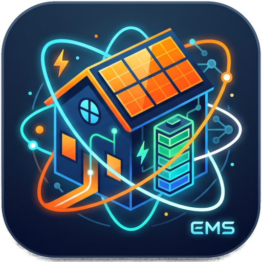

# Sungrow EMS for Home Assistant

<p align="center">
  
</p>

[](https://github.com/Maximo101/sungrow_ems/releases)
[](https://hacs.xyz/docs/faq/custom_repositories)


A **100 % local** Home Assistant integration for Sungrow hybrid inverters and the Sungrow **iHomeManager** (iHM), over Modbus TCP. It gives you fast telemetry and ready-made energy tracking, plus a small set of opt-in controls, with no iSolarCloud account, no cloud polling and no YAML.

> [!WARNING]
> **Beta / pre-release.** Tested on one system so far (see [Tested hardware](#tested-hardware)). Please report what works and what doesn't on yours.

## What's new in 0.2.0

0.2.0 is the first GitHub release since 0.1.8. It brings in everything from 0.1.9 and 0.1.10 (never published separately) plus the new opt-in control. Full detail per version is in the [CHANGELOG](CHANGELOG.md).

**New**
- **Opt-in control** (off by default): Backup reserve, iHM energy management mode, EV charger mode, AC22 charge current (unverified), and a **forced charge to a target SoC** that puts every setting back afterwards. See [Control](#control-opt-in-advanced).
- **PVOutput.org upload** (optional, off by default): live status or a daily summary, with donation-mode extras (battery values b1–b5, v7–v12 from any entity) and a *Push to PVOutput now* action. See [PVOutput.org upload](#pvoutputorg-upload-optional).
- **Model profiles** keyed by the inverter's model code, so single-phase SHxxRS and three-phase SHxxT models run through the same code. On a three-phase model the phase B/C sensors are enabled once and registers the model doesn't have are skipped.
- **Register snapshot tool and mock server** for development (`scripts/dump_registers.py`, `tests/mock_modbus_server.py`).
- Inverter power limitation readback (13088–13090, disabled by default) and more diagnostics (per-block age, temporary rejections, write log).

**Improved**
- **Daily consumption is now a true energy balance**: PV + import − export − battery charge + battery discharge, with no efficiency factor. The old formula counted grid energy that went into the battery as house load (on a day with 18 kWh of grid charging it read 74.9 kWh against 58.4 kWh measured by the iHomeManager; it now reads 59.4). **Self sufficient** and **Purchased %** follow: battery energy counts as your own whatever charged it. See [Consumption and self-sufficiency](#consumption-and-self-sufficiency).
- **Daily battery charge from grid** no longer flickers down by 0.1 kWh during the day.
- Register map checked against inverter protocol **V1.1.17**. Running state, DRM state, protocol version and model names are decoded properly.
- **Time until fully charged / discharged** show hours and minutes (*7h 27m*), with `minutes` and `finishes_at` attributes.
- **PV split behind an iHM** now counts today's export correctly (it used the inverter's PV export counter, which reads 0 when the meter is on the iHM).
- Inverter settings are read every 5 minutes instead of every minute, as the protocol asks for settings read through a WiNet-S.
- A register that the WiNet-S rejects for a moment is no longer marked "not supported" for an hour.
- Battery current/power (13021/13022) no longer drop −0.1 A / −1 W readings.

### Upgrading from 0.1.8

- **Nothing is written to your devices** unless you turn on *Enable control* in the options.
- **With an iHomeManager**, *Total PV export*, *Daily direct consumption* and *Total direct consumption* are disabled once (they need a meter wired to the inverter and read 0 behind an iHM). Turn them back on if you want them; that is respected.
- **Time until fully charged / discharged** are now text sensors. Home Assistant may offer to delete their old long-term statistics.
- **iHM Device type** is now **Model** and shows *iHomeManager*. The entity ID is unchanged.
- **Inverter Protocol number** (disabled by default) is removed: Sungrow made those registers reserved.
- Changes to Min SoC, Max SoC or Backup reserve made in the app can take up to 5 minutes to show.
- **Daily consumption, Self sufficient and the two percentages change from the day you update** (see above). Past days keep their old values. The *Battery discharge efficiency* option is gone; it is removed from your settings automatically.
- No other entity IDs or unique IDs changed, so history and the Energy dashboard carry over.

## Read-only by default

Out of the box Sungrow EMS is a **telemetry and energy-tracking** integration. It **does not write** to your inverter, battery, iHomeManager or EV charger unless you turn on **Enable control** in the options.

- With control off, the only Modbus function codes it sends are **FC03** and **FC04** (read holding / input registers), there are no `number` or `select` entities, and the control actions refuse to run.
- Settings such as EMS mode, SOC limits, export limit and EV charger mode are shown as **read-only diagnostic sensors**.

## Control (opt-in, advanced)

> [!CAUTION]
> Writes change settings on your inverter and iHomeManager, and the iSolarCloud app shows the new values. Register behaviour differs across models and regional firmware. Turn control on only if you accept that, and keep the app at hand to put things back.

**Settings → Devices & services → Sungrow EMS → Configure → Enable control (advanced)**

Only these settings can be written, and only within their documented ranges:

| Entity / action | Register | Notes |
|---|---|---|
| *Backup reserve* (number), action `sungrow_ems.set_backup_reserve` | inverter HR 13100 | Min SoC … 100 %. On grid, a battery below the reserve is charged up to it |
| *Energy management mode* (select, iHM) | iHM HR 8024 | Self-consumption (1) or Forced mode (5, *Compulsory*). The app's AI mode and Time plan have no documented code: they show as *unknown* with the raw code |
| *EV charger mode* (select, iHM) | iHM HR 8048 | Fast / ECO & fast / ECO & economic. *Time plan* needs **Allow unverified writes** |
| *EV charge current* (number, AC22) | AC22 HR 21203 | Only with an **AC22 unit ID** set and **Allow unverified writes** (community register map) |
| `sungrow_ems.force_charge_start` / `force_charge_cancel` | iHM 8024–8026, or inverter 13050–13052 without an iHM, or 13100 | See below |
| *Force charge state* (sensor) | — | `idle`, `charging`, `target_reached`, `aborted`, with the session in the attributes |

Every write goes through one guarded path: an allowlist of registers, the model's documented support, range checks against live limits (Min SoC, the iHM's charge limit), no write when the value is already set, a per-register cooldown, a daily write budget per register (EEPROM wear) and a read-back to confirm the value. Writes are refused while that device is not answering polls.

**Forced charge to a target SoC.** `force_charge_start` reads the current energy-management settings from the device, stores them, switches to Forced mode at the given power (default: the iHM's charge/discharge upper limit, 8149; the iHM holds the actual power to what the battery accepts), watches the battery SoC and puts the exact previous settings back when the target is reached, on the time limit (option, default 240 min), on `force_charge_cancel`, and when Home Assistant stops. The session is saved before the first write, so after a crash or power cut the settings are restored on the next start. If someone changes the mode in the app during the charge, the integration stops and does not fight it. With `method: reserve` the Backup reserve is raised to the target instead: the inverter charges and holds that level itself, and the reserve is put back afterwards.

## Key metrics

A selection of the 194 entities (some are disabled by default). Home Assistant shows each entity with its device name in front, e.g. *SH10RS Daily PV generation* or *iHM Battery SoC*. Entity IDs keep the `sungrow_ems_inverter_` / `sungrow_ems_ihomemanager_` prefixes whatever the devices are called.

| Metric | Entity | Unit | Source |
|---|---|---|---|
| Solar production now | `sensor.sungrow_ems_inverter_pv_dc_power` | W | Inverter |
| Solar production today / lifetime | `…inverter_daily_pv_generation`, `…inverter_total_pv_generation` | kWh | Inverter |
| MPPT 1–4 voltage and current | `…inverter_mppt1_voltage`, `…inverter_mppt1_current`, … | V, A | Inverter |
| House load now | `sensor.sungrow_ems_ihomemanager_load_power` | W | iHM |
| Grid power now (+ import, − export) | `sensor.sungrow_ems_ihomemanager_grid_active_power` | W | iHM |
| Grid import / export now (split) | `…ihomemanager_active_import_from_grid`, `…ihomemanager_active_export_to_grid` | W | Calculated |
| Grid import / export lifetime (spike-filtered) | `…ihomemanager_grid_import_safe`, `…ihomemanager_grid_export_safe` | kWh | Calculated |
| Grid import / export today | `…ihomemanager_daily_import`, `…ihomemanager_daily_export` | kWh | Calculated |
| Battery state of charge | `sensor.sungrow_ems_inverter_battery_soc` | % | Inverter |
| Battery status (Charging / Discharging / Idle) | `sensor.sungrow_ems_inverter_battery_status` | text | Calculated |
| Battery usable energy | `sensor.sungrow_ems_inverter_battery_usable_energy` | kWh | Calculated |
| Time until fully charged / discharged | `…inverter_time_until_fully_charged`, `…inverter_time_until_fully_discharged` | text, e.g. `7h 27m` (minutes in the `minutes` attribute) | Calculated |
| Battery power (charging / discharging split) | `…inverter_battery_charging_power`, `…inverter_battery_discharging_power` | W | Calculated |
| Battery charge / discharge today | `…inverter_daily_battery_charge`, `…inverter_daily_battery_discharge` | kWh | Inverter |
| Battery health, temperature, voltage | `…inverter_battery_health`, `…inverter_battery_temperature`, `…inverter_battery_voltage` | %, °C, V | Inverter |
| Consumption today | `sensor.sungrow_ems_inverter_daily_consumption` | kWh | Calculated |
| Self-sufficiency today | `…inverter_self_sufficient`, `…inverter_self_sufficient_percentage` | kWh, % | Calculated |
| Where today's PV went (battery / home / grid) | `…inverter_battery_charged_from_pv_percentage`, `…inverter_daily_consumption_from_pv_percentage`, `…inverter_daily_export_to_grid_percentage` | % | Calculated |
| EV charger power and status | `…ihomemanager_ev_charger_power`, `…ihomemanager_ev_charger_status` | W, text | iHM |
| System status (decoded power flow) | `sensor.sungrow_ems_inverter_system_status` | text | Calculated |
| Inverter state and temperature | `…inverter_running_state`, `…inverter_temperature` | text, °C | Inverter |
| Grid voltage and frequency | `…ihomemanager_grid_voltage_a`, `…ihomemanager_grid_frequency` | V, Hz | iHM |
| Off-grid, inverter fault, EV charger fault | `binary_sensor.sungrow_ems_inverter_off_grid_backup_mode`, `…inverter_inverter_fault`, `…ihomemanager_ev_charger_fault` | on/off | Calculated |
| Connection (on = being polled) | `binary_sensor.sungrow_ems_inverter_connection`, `…ihomemanager_connection` | on/off | Diagnostic |
| Last successful poll, with counters (disabled by default) | `…inverter_last_successful_poll`, `…ihomemanager_last_successful_poll` | timestamp | Diagnostic |

### Energy dashboard

| Energy dashboard slot | Entity |
|---|---|
| Grid consumption | `sensor.sungrow_ems_ihomemanager_grid_import_safe` |
| Return to grid | `sensor.sungrow_ems_ihomemanager_grid_export_safe` |
| Solar production | `sensor.sungrow_ems_inverter_total_pv_generation` |
| Battery: energy going in | `sensor.sungrow_ems_inverter_total_battery_charge_cumulative` |
| Battery: energy coming out | `sensor.sungrow_ems_inverter_total_battery_discharge` |

## Features

- **Fully local Modbus TCP.** Reads the inverter (via WiNet-S / LAN) and the iHomeManager directly. Nothing leaves your network.
- **Two independent coordinators**, one per device, so a slow or offline iHM never stalls inverter data (and vice versa).
- **Fast polling.** 10 s default for both devices (5 s minimum). The iHM's mandatory 1 s gap between requests is respected automatically.
- **Efficient block reads.** 163 registers in 17 batched blocks. Live values are read every poll; inverter settings every 5 minutes (as the protocol asks for read-write registers over WiNet-S), iHomeManager settings once a minute, and identity once an hour. If a device rejects part of a block, the hub splits it and remembers the working split.
- **Resilient.** Last-known-good values are kept through short dropouts. Entities go unavailable only after a configurable number of failed polls (default 6). Reconnects use exponential backoff, and sockets are always released on unload, reload and failed setup.
- **Sentinel filtering.** Sungrow's "not available" values (`0xFFFF`, `0x7FFF`, …) and out-of-range readings are dropped instead of appearing as spikes.
- **Native replacements for common YAML templates:** spike-filtered grid totals, midnight-reset daily meters, daily consumption, self-sufficiency, PV split percentages (always sum to 100), battery status, usable energy and time-to-full / time-to-empty estimates, split import/export and charge/discharge power, and a decoded System Status sensor.
- **Opt-in control** with one guarded write path: allowlisted registers only, range checks against live limits, no write when nothing changes, cooldowns, a daily write budget per register, and read-back to confirm. Off by default.
- **Forced charge to a target SoC** that restores your previous settings on target, time limit, cancel, Home Assistant stop, and after a crash.
- **Model profiles** for SHxxRS and SHxxT, keyed by the model code the inverter reports.
- **Optional PVOutput.org upload** of the values already polled (live or daily).
- **Blueprints** for battery SoC alerts, grid outage / restore alerts and EV charger fault alerts.
- **Diagnostics.** Per-device poll status sensors, plus a redacted *Download diagnostics* report (hosts and serial number removed).
- **Runs beside other Sungrow integrations.** Unique IDs carry an `_ems` suffix and devices have their own names.

## Tested hardware

| Component | Model / firmware | Connection |
|---|---|---|
| Hybrid inverter | SH10RS (10 kW single-phase), WiNet-S | Modbus TCP 502, unit ID 1 |
| Battery | Sungrow SBR192 × 2 (38.4 kWh) | via inverter |
| Gateway | iHomeManager, firmware SV930.001.00.P014 | Modbus TCP 503, unit ID 247 |
| EV charger | Sungrow AC22E-01 | via iHomeManager |

Tested on Home Assistant 2026.10.4. The test suite (144 tests) runs against a simulated inverter and iHomeManager, and against a Modbus TCP mock server seeded from a real register snapshot.

Other SH-series hybrids that implement the *Communication Protocol of Residential and Small Industrial Hybrid Inverter* (V1.1.x) should work, since the register map follows the protocol, but they haven't been tested. Three-phase models (SHxxRT, SHxxT) are untested; the model profile enables their phase B/C sensors and skips registers they don't have. An SH20T is planned for this site. **Reports from other models are very welcome.**

The iHomeManager is optional. Without it you still get every inverter sensor, but grid-meter totals, the EV charger and the iHM-based derived sensors won't be available.

## Requirements

| Device | Port | Unit (slave) ID | Notes |
|---|---|---|---|
| SH-RS hybrid inverter (WiNet-S / WiNet-S2 or LAN) | **502** | **1** | Modbus TCP must be enabled on the dongle |
| iHomeManager | **503** (or 504) | **247** | Fixed by the iHM protocol; one TCP connection per port |

- **Inverter:** Modbus TCP must be enabled on the WiNet-S / WiNet-S2 (or LAN) interface.
- **iHomeManager (optional):** Modbus TCP must be enabled on the iHM during local commissioning (by your installer or via local access). The iHM listens on ports **502, 503 and 504** and allows **only one TCP connection per port**. If another tool (SunGather, another integration) already holds 503, use 504.
- A fixed IP (DHCP reservation) for both devices is strongly recommended.
- Home Assistant **2026.10 or newer**.

## Installation

### Marketplace on Home Assistant (formerly HACS - custom repository)

You can add a custom respository.
1. In Settings go to 'Marketplace', open the menu (⋮) → **Custom repositories**.
2. Add from Link `https://github.com/Maximo101/sungrow_ems` with category **Integration**.
3. Find **Sungrow EMS** in HACS and download it. Pre-releases are listed when you enable **Show beta versions** on the integration's page in HACS.
4. Restart Home Assistant.

<p align="center">
  
</p>

### Manual

1. Download the source code from the [latest release](https://github.com/Maximo101/sungrow_ems/releases).
2. Copy the `custom_components/sungrow_ems/` folder into your `config/custom_components/` folder (so `config/custom_components/sungrow_ems/manifest.json` exists).
3. Restart Home Assistant.

## Configuration

**Settings → Devices & services → Add integration → Sungrow EMS**

| Field | Default | Notes |
|---|---|---|
| Inverter host IP | — | IP Address of the WiNet-S / LAN interface (Direct ethernet connection prefered) |
| Inverter port | 502 | | (default)
| Inverter unit ID | 1 | | (default)
| Use iHomeManager | on | Turn off if you don't have one |
| iHomeManager host IP | — | IP Address of iHM. (Required when the iHM is enabled) |
| iHomeManager port | 503 | Use 504 if 503 is taken |
| iHomeManager unit ID | 247 | Fixed by the iHM protocol; leave as is |

**NOTE: Set a Static IP address in your router to fix the IP addresses of your devices**
If using 504 Port on iHM, you will need to login to your sungrow settings and enable port 504.

The integration reads the inverter serial number during setup and uses it as the entry's unique ID, so the same inverter can't be added twice. Hosts and ports can be changed later with **Reconfigure**.

<p align="center">
  
</p>

### Options

**Settings → Devices & services → Sungrow EMS → Configure**

| Option | Default | What it does |
|---|---|---|
| Inverter poll interval | 10 s | 5–300 s |
| iHomeManager poll interval | 10 s | Keep ≥ 10 s; each poll is about 3 paced requests |
| Request timeout | 3 s | Per Modbus request |
| Retries per request | 2 | Extra attempts after a timeout or busy reply |
| Minimum gap between iHM requests | 1.0 s | Protocol minimum is 1.0 s |
| Failed polls before unavailable | 6 | Until then, last good values are held |
| Battery capacity override | 0 (auto) | Rated capacity. 0 = read from the hardware (iHM 8147 → inverter 13039 → 5639) |
| Spike filter: largest jump | 50 kWh | Grid Import/Export Safe ignore bigger single steps |
| Spike filter: largest daily total | 200 kWh | Daily values above this are treated as corrupt |
| Spike filter: readings to re-baseline | 3 | Consistent readings needed to accept a new baseline |
| Enable control (advanced) | off | See [Control](#control-opt-in-advanced) |
| Allow unverified writes | off | AC22 charge current and the EV charger's Time plan |
| AC22 unit ID behind the WiNet-S | 0 (off) | From the WiNet-S web device list |
| Forced charge time limit | 240 min | 10–720 min |
| Enable PVOutput | off | See [PVOutput.org upload](#pvoutputorg-upload-optional) |

Saving changed options reloads the integration.

## PVOutput.org upload (optional)

Off by default. Turn on **Enable PVOutput** during setup or in **Configure**, then follow the steps:

1. **Account:** API key (with write access) and system ID from *pvoutput.org → Settings → API Settings*, account type (*Free* or *Donation*) and upload mode. They are checked against PVOutput before you continue.
2. **Live status** (default): uploads every 5, 10 or 15 minutes on the clock (or *Auto*, following the Status Interval of your PVOutput system). Sends **power** (v2 + v4, recommended) or **energy** (v1 + v3), plus temperature (v5) and grid voltage (v6). **Daily output** instead sends one summary a day (generation, consumption, export, peak power) at the time you choose.
3. **Values:** each parameter is *Auto* (the integration's own source), another source, or *Do not send*.

| Parameter | Auto source |
|---|---|
| v1 / v2 | Daily PV generation / PV DC power |
| v3 / v4 | Daily consumption / iHM load power (inverter load power without an iHM) |
| v5 | Inverter temperature (left out at exactly 0 °C, inverter asleep) |
| v6 | iHM grid voltage A (left out below 90 V) |
| v7–v12 (donation) | Any Home Assistant entity you pick; empty by default |
| b1–b5 (donation) | Battery power (+ charging), SoC, usable battery size, lifetime charge, lifetime discharge |

- **PVOutput last upload** and **PVOutput donation status** sensors show what happened; they are removed again if you turn PVOutput off.
- The `sungrow_ems.pvoutput_push_now` action sends one upload straight away, to test the setup.
- A rate limit pauses uploads until PVOutput allows them again. If a donation lapses, uploads carry on with the standard values only.
- PVOutput is the only part of the integration that talks to the internet. It only reads values that were already polled and never touches the devices.

## Entities

Two devices are created: the inverter, named after its model as read over Modbus (for example **SH10RS**, or **Inverter** if the model code is unknown), and **iHM** for the iHomeManager. Renaming them in Home Assistant is fine; entity IDs do not change.
Some rarely useful or unreliable sensors are disabled by default; enable them from the device page if you need them. Holding-register readbacks (settings) are diagnostic entities.
Refer to table below for examples.

### Consumption and self-sufficiency

- **Daily consumption** = PV + grid import − grid export − battery charge (13040) + battery discharge (13026). Checked against the iHomeManager's own load measurement over full days: within 1–2 %. It reads about 2–3 % below iSolarCloud's *Load*, which counts battery discharge on the battery (DC) side. Needs an iHomeManager for the grid figures.
- **Self sufficient (kWh)** = PV used in the home + battery discharge used in the home. Energy bought for the home is import minus what went from the grid into the battery, so battery energy counts as your own whatever charged it. **Self sufficient %** and **Purchased %** are shares of Daily consumption and always add up to 100. iSolarCloud counts all grid charging as purchased, so on days with grid charging its self-sufficiency is lower.
- **Daily battery charge from grid** = total charge (13040) − charge from PV (13012). It only goes up during the day.

### Battery sensors

Nothing here uses a fixed capacity; every figure comes from live readings.

- **Battery status** follows the inverter's own power-flow flags (register 13001), with the sign of the battery power as the fallback.
- **Battery usable energy** is the energy you can draw before discharging stops. The SoC the inverter reports runs from 0 % at *Min SoC* to 100 % at *Max SoC*, so the capacity behind it is `rated capacity × (Max SoC − Min SoC)`. While the grid is up, the *Backup reserve SoC* is held back and is not counted; in off-grid (backup) mode it is. The attributes show the parts: `usable_capacity_kwh`, `stored_energy_kwh` (everything above Min SoC), `reserved_energy_kwh`, `energy_to_full_kwh` and `discharge_floor`.
- **Time until fully charged / fully discharged** divide the energy still to go by the battery power averaged over two minutes. "Fully discharged" means the point where discharging stops: the backup reserve on grid, Min SoC off grid. They are shown as hours and minutes (for example *7h 27m*); the `minutes` attribute has the number for automations and `finishes_at` the estimated clock time. Each shows *Unknown* while the battery is going the other way or is idle. Charging slows near 100 %, so the last part of a charge takes longer than the estimate.

The SoC scaling between Min SoC and Max SoC is how Sungrow hybrids are observed to behave; it is not stated in the protocol document. If your system behaves differently, please open an issue.

## Blueprints

Three automation blueprints are in [`blueprints/automation/sungrow_ems/`](blueprints/automation/sungrow_ems). They are not installed with the integration: import the ones you want.

| Blueprint | What it does | Import |
|---|---|---|
| Battery SoC alert | Notifies when the SoC stays below or above a level. One automation per level. | [](https://my.home-assistant.io/redirect/blueprint_import/?blueprint_url=https%3A%2F%2Fgithub.com%2FMaximo101%2Fsungrow_ems%2Fblob%2Fmain%2Fblueprints%2Fautomation%2Fsungrow_ems%2Fbattery_soc_alert.yaml) |
| Grid outage and restore alert | Notifies when the system goes off grid and when the grid is back. | [](https://my.home-assistant.io/redirect/blueprint_import/?blueprint_url=https%3A%2F%2Fgithub.com%2FMaximo101%2Fsungrow_ems%2Fblob%2Fmain%2Fblueprints%2Fautomation%2Fsungrow_ems%2Fgrid_outage_alert.yaml) |
| EV charger fault alert | Notifies when the EV charger reports a fault, with the fault code. | [](https://my.home-assistant.io/redirect/blueprint_import/?blueprint_url=https%3A%2F%2Fgithub.com%2FMaximo101%2Fsungrow_ems%2Fblob%2Fmain%2Fblueprints%2Fautomation%2Fsungrow_ems%2Fev_charger_fault_alert.yaml) |

Or go to **Settings → Automations & scenes → Blueprints → Import blueprint** and paste the file's GitHub address. Each blueprint asks for the entity to watch and the notify action to call (for example `notify.mobile_app_my_phone`), and can run extra actions of your own.

## Running beside the original integration

You can run Sungrow EMS next to the cloud/hybrid integration it grew out of while you validate the numbers:

1. Leave the existing integration on iHM port **503**.
2. Add Sungrow EMS with iHM port **504**.
3. Compare history, then remove the old integration (and stop SunGather or any other poller) once you're happy.

Because the iHM only accepts one connection per port, two pollers on the same port will fight and both will see timeouts.

## Known limitations

- **Inverter total battery charge (13041)** returns an invalid high word on the SH10RS and is rejected; use *Total battery charge cumulative* (integrated from battery power) instead.
- **Inverter meter registers** (13029, 13036–13038, 13045–13047) read 0 when the iHM does the metering, so they're disabled by default. Use the iHM meter sensors.
- **Settings sensors update slowly**, not every poll: inverter settings (Min/Max SoC, backup reserve, limits) every 5 minutes, iHomeManager settings (EMS mode, EV charger mode) once a minute.
- **WiNet-S caching (suspected):** the inverter sometimes repeats identical values for about 2 minutes while polls still succeed. The poll status sensors expose `seconds_since_value_change` to help confirm this.
- **EV charger power (iHM 8594)** isn't in the current iHM protocol document and is marked unverified.
- **iHM 8049 / 8050** (charger enable / grid draw) read "Disable" in every charger mode tested; their meaning on current firmware is still unclear.
- The iHM export-limit registers (8028 / 8031) are a separate Modbus limitation layer and don't reflect the export limit set in the iSolarCloud app. Their sensors are disabled by default.
- **Grid state (13030)** is a reserved register in the current inverter protocol and reads "Not reported" on current firmware; it is disabled by default. Use *Off-grid (backup) mode* instead.
- Three-phase models (SHxxRT, SHxxT) are untested. The model profile already skips registers they don't have (for example MPPT 4 on an SH20T) and enables the phase B/C sensors once when a three-phase inverter is detected.

## Troubleshooting

- **Cannot connect during setup:** check the IP and port, make sure Modbus TCP is enabled on the WiNet-S, and that nothing else holds the iHM port you chose.
- **Entities flicker unavailable:** raise *Failed polls before unavailable* or the timeout in Options.
- **Debug logging:**

  ```yaml
  logger:
    default: warning
    logs:
      custom_components.sungrow_ems: debug
      pymodbus: info
  ```

When opening an issue, please attach the diagnostics download (**Settings → Devices & services → Sungrow EMS → ⋮ → Download diagnostics**) and include your inverter model, iHM firmware and Home Assistant version.

## Development

```bash
pip install -r requirements_test.txt
pytest
ruff check . && ruff format --check .
```

**Register snapshot and mock server.** `scripts/dump_registers.py` reads every documented register block of the inverter, iHM (and optionally the battery and AC22 units behind the WiNet-S) and writes a JSON + CSV snapshot. `tests/mock_modbus_server.py` serves such a snapshot over Modbus TCP, keeps written settings and simulates the battery (SoC, power, forced charge, emergency charge below the reserve), so the integration can be developed with the hardware disconnected:

```bash
python3 scripts/dump_registers.py --inverter <winet-ip> --ihm <ihm-ip> --redact
python3 tests/mock_modbus_server.py snapshots/snapshot_SH10RS_<time>.json --speed 10
```

Snapshots contain the serial number and IP addresses unless `--redact` is used; don't commit them.

## Credits

Sungrow EMS started life as a fork of **[sungrow-solarcloud-haos-integration](https://github.com/Cyber40014/sungrow-solarcloud-haos-integration)** by **[@Cyber40014](https://github.com/Cyber40014)**.
Huge thanks for the original integration: its entity keys (`mb_*`, `ihm_*`) and register selection are the foundation this project was built on. Since then the code has been rewritten as a local-only Modbus integration, with the cloud API removed and the coordinators, Modbus hub, register map and derived sensors redone from scratch.

Also thanks to:

- **[SunGather](https://github.com/bohdan-s/SunGather)** by [@bohdan-s](https://github.com/bohdan-s), whose community register map was cross-checked for registers not covered by Sungrow's documents (those are flagged as unverified in `registers.py`).
- **Sungrow**, for publishing the *Communication Protocol of Residential and Small Industrial Hybrid Inverter* (V1.1.17) and the *iHM Communication Protocol* (V1.0.2), which every register here is cross-referenced against.
- The **[pymodbus](https://github.com/pymodbus-dev/pymodbus)** project.

## Disclaimer

This is an independent community project. It is **not affiliated with, endorsed by or supported by Sungrow**. "Sungrow", "iSolarCloud", "iHomeManager" and "WiNet" are trademarks of their respective owners.
